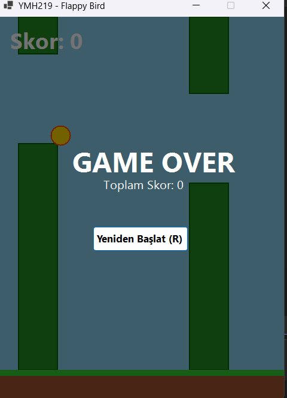
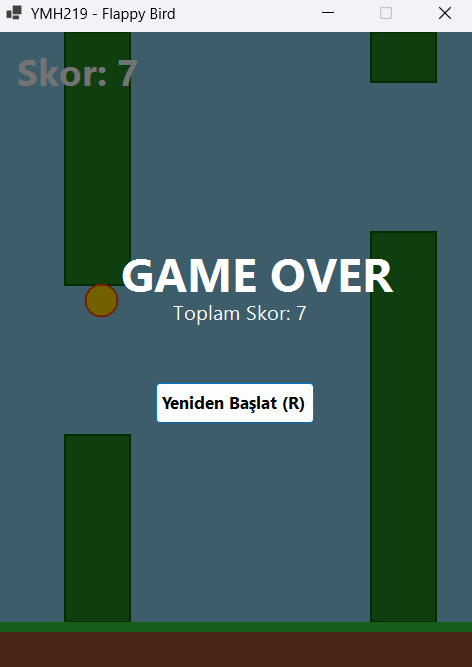
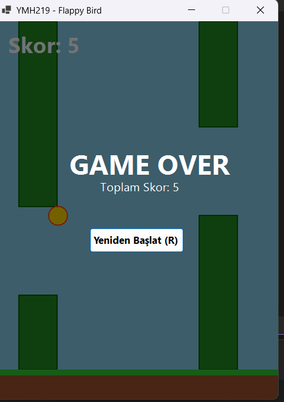

# YMH219-FlappyBird

Nesne Tabanli Programlama (YMH 219) dersi kapsaminda gelistirilen Windows Forms Flappy Bird benzeri masaustu oyunudur.

## Kullanilan Teknolojiler
* C# ve .NET Windows Forms
* Visual Studio Insiders
* Harici NuGet paketi kullanilmamistir

## Kurulum ve Calistirma Adimlari
1. Depoyu bilgisayara klonlayin: git clone https://github.com/elifbaburhan/YMH219-FlappyBird.git
2. Proje cozumunu veya projesini Visual Studio ile acin.
3. Projeyi derleyip (Ctrl + Shift + B) calistirin (F5).

## Temel Ozellikler
* Space ve Yukari Ok tuslariyla ziplama, yer cekimi etkisiyle dusme (PlayerBird)
* Sagdan sola hareket eden ve ekran disina cikinca yeniden konumlanan engeller (PipeObstacle)
* Carpisma tespiti, skor sayimi, GAME OVER ekrani ve R / buton ile yeniden baslatma (GameState)

## Ekran Goruntuleri

## Bilinen Sinirlamalar / Gelistirme Notlari
* Temel surumde ses efekti ve kalici yuksek skor kaydi bulunmamaktadir; ileride seviye hizlanma ve ses destegi eklenebilir.

## Ogrenci Bilgileri
* **Ad - Soyad:** Elif Baburhan
* **Ogrenci Numarasi:** 250541022
